<p align="center">
  
</p>

<h1 align="center">Jellio for Samsung Tizen</h1>

<p align="center">
  The Samsung Tizen Smart TV client for Jellio, built to match Jellio TV 1:1<br>
  for 2018 and newer Samsung TVs (Tizen 4.0+).
</p>

## Features

- **Dual-engine hardware playback**: native Samsung `AVPlay` pipeline for 4K, HDR10,
  Dolby Vision, and multi-channel audio passthrough, with automatic HTML5 `<video>`
  fallback, trickplay scrubbing, subtitle offset and size controls, and Skip Intro /
  Skip Credits.
- **Stream warmup & resilience**: proactive background stream warmup with `Ready`
  badges, automatic failover across alternate versions and editions, and continuous
  playback reporting.
- **2D spatial remote navigation**: full D-pad spatial navigation tuned for Samsung
  remotes (including color buttons, channel keys, and media transport keys) with custom
  Quick Hub remote button recording.
- **Quick Hub & Dynamic Island Home pill**: slide-over drawer and top-screen status
  pill for live Now Playing handoff across devices, server notifications, Group Watch
  parties, and Friends.
- **Home discovery & Studio Hubs**: hero carousel, Continue Watching, Next Up,
  weighted Top Picks, Because You Watched, Studio Hubs, Coming Soon calendar, and
  customizable row layouts synced with your server.
- **Live TV, Search & Social**: Live TV channel browser and player, typo-tolerant
  fuzzy search, rich TMDB actor and crew pages, shared friend watchlists with avatar
  badges, user profiles with achievement badges and activity feed, localization in 7
  languages (English, German, Spanish, French, Italian, Polish, Portuguese), and much
  more.

## Requirements

- A Samsung Smart TV running **Tizen 4.0 or later** (2018 model year and newer)
- A Jellyfin server running the [Jellio plugin](https://github.com/NoahSKipp/Jellio)
- [Tizen Studio](https://developer.samsung.com/smarttv/develop/tools/tizen-studio.html)
  (CLI or IDE) with a Samsung certificate profile for sideloading

## Sideloading onto your TV

### 1. Enable Developer Mode on your Samsung TV

1. Open the **Apps** panel on your TV.
2. Press `1`, `2`, `3`, `4`, `5` in sequence on your remote to open the Developer Mode
   dialog.
3. Set **Developer mode** to **On** and enter the IP address of the computer running
   Tizen Studio.
4. Hold the power button on your remote until the TV reboots.

### 2. Package and install with Tizen Studio CLI

Connect to your TV and install the `.wgt` package (replace `<TV_IP>` with your TV's local
IP address and `<PROFILE_NAME>` with your Tizen certificate profile):

```bash
git clone https://github.com/NoahSKipp/Jellio-Tizen.git
cd Jellio-Tizen

sdb connect <TV_IP>
tizen package -t wgt -s <PROFILE_NAME> -- .
tizen install -n Jellio.wgt -t <TV_DEVICE_NAME>
```

Once installed, open **Jellio** from your TV's Apps row, enter your Jellyfin server
address, and sign in.

## Development & Tests

Jellio for Tizen is written in zero-build ES6 modules so it can be packaged directly by
`tizen package` without a bundler step.

Run the test suite with Node.js:

```bash
npm test
```

## Credits

- UI/UX matched to [Jellio TV](https://github.com/NoahSKipp/Jellio-TV) and inspired by
  [NuvioTV](https://github.com/NuvioMedia/NuvioTV)

## License

GNU General Public License v3.0